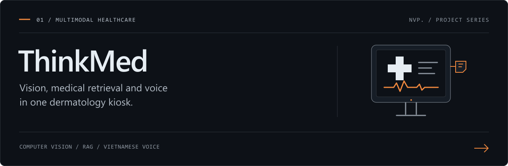
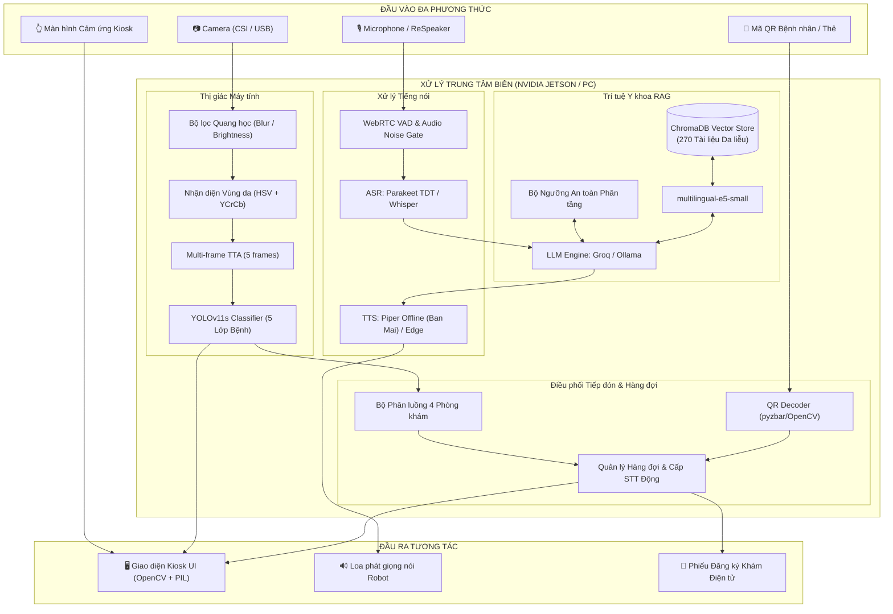

# 🩺 ThinkMed: Hệ thống Kiosk AI Đa phương thức Sàng lọc Bệnh Da liễu & Tư vấn Y tế Thông minh

[](https://www.python.org/)
[](https://pytorch.org/)
[](https://github.com/ultralytics/ultralytics)
[](https://www.nvidia.com/en-us/autonomous-machines/embedded-systems/)
[](https://www.trychroma.com/)
[](https://groq.com/)
[](LICENSE)

> **ThinkMed** (phát triển bởi nhóm **TechCool**) là giải pháp Kiosk y tế thông minh tích hợp Trí tuệ nhân tạo đa phương thức (*Multimodal Edge AI*). Hệ thống hỗ trợ người dân tự sàng lọc ban đầu các bệnh da liễu phổ biến, tiếp đón và cấp số thứ tự khám chuyên khoa tự động, đồng thời cung cấp trợ lý đàm thoại y khoa hai chiều an toàn bằng tiếng Việt.

---

## 📑 Mục lục
- [1. Tính năng nổi bật](#-tính-năng-nổi-bật)
- [2. Kiến trúc hệ thống](#-kiến-trúc-hệ-thống)
- [3. Cấu trúc thư mục dự án](#-cấu-trúc-thư-mục-dự-án)
- [4. Yêu cầu phần cứng & Phần mềm](#-yêu-cầu-phần-cứng--phần-mềm)
- [5. Hướng dẫn cài đặt](#-hướng-dẫn-cài-đặt)
- [6. Hướng dẫn khởi chạy & Sử dụng](#-hướng-dẫn-khởi-chạy--sử-dụng)
- [7. Kiểm thử & Chẩn đoán hệ thống](#-kiểm-thử--chẩn-đoán-hệ-thống)
- [8. Chuẩn mực An toàn Y tế & Bảo vệ dữ liệu](#-chuẩn-mực-an-toàn-y-tế--bảo-vệ-dữ-liệu)
- [9. Đội ngũ phát triển (TechCool)](#-đội-ngũ-phát-triển-techcool)

---

## 🌟 Tính năng nổi bật

### 1. 👁️ Sàng lọc Thị giác Máy tính Tức thì (Edge Vision AI)
- **Mô hình YOLOv11s tối ưu hóa:** Nhận diện 5 nhóm bệnh da liễu phổ biến:
  - Mụn trứng cá (`acne`)
  - Viêm da cơ địa (`atopic_dermatitis`)
  - Vẩy nến (`psoriasis`)
  - Nấm da (`tinea`)
  - Mụn cóc do virus (`wart`)
- **Bộ lọc kiểm soát chất lượng quang học (Quality Gate):** Tự động phát hiện ảnh mờ (Laplacian variance), ảnh thiếu sáng hoặc chói lóa trước khi đưa vào mạng nơ-ron.
- **Phát hiện vùng da người (Skin Presence Detection):** Kết hợp đồng thời không gian màu HSV và YCrCb để loại trừ các trường hợp đưa vật thể, quần áo hoặc phông nền vào camera.
- **Cơ chế Khóa vùng da & Tự động chụp 3s:** Khi người bệnh đưa vùng tổn thương vào đúng ô ngắm và giữ ổn định, hệ thống tự động khóa nét và đếm ngược 3 giây để chụp.
- **Kỹ thuật Multi-frame TTA (Test-Time Augmentation):** Thu nhận liên tiếp 5 khung hình để lấy trung bình trọng số xác suất, nâng cao độ tin cậy và triệt tiêu nhiễu rung lắc.

### 2. 🪪 Đăng nhập & Tiếp đón qua Mã QR (Smart QR Check-in)
- Nhận diện tức thì thẻ bệnh nhân qua mã QR bằng bộ giải mã độc lập `pyzbar` / `cv2.QRCodeDetector` (không phụ thuộc QUIRC, chạy mượt trên cả Jetson Linux và Windows).
- Tự động chào đón bệnh nhân bằng giọng nói tiếng Việt theo tên riêng.
- Hỗ trợ lưu thông tin định danh để tự động in lên phiếu khám bệnh.

### 3. 🏥 Phân luồng & Cấp số thứ tự Động (Smart Queue & Room Routing)
- Tự động gợi ý phòng khám chuyên khoa phù hợp với tình trạng tổn thương da:
  - **Phòng 101:** Khám Da liễu & Thẩm mỹ da (cho mụn trứng cá).
  - **Phòng 102:** Khám Dị ứng & Miễn dịch da (cho viêm da cơ địa).
  - **Phòng 103:** Khám Da liễu Mạn tính & Tự miễn (cho vẩy nến).
  - **Phòng 104:** Xét nghiệm Vi nấm & Ký sinh trùng / Thủ thuật da liễu.
- **Quy trình đặt lịch linh hoạt:** Bệnh nhân có thể trả lời *"Có"* hoặc *"Không"* bằng giọng nói hoặc chạm nút trên màn hình cảm ứng.
- **Hệ thống cấp số thứ tự động (Dynamic STT):** Cấp số khám tăng tiến tự động (STT 14, 15, 16...), hiển thị phiếu khám điện tử và đọc hướng dẫn di chuyển.

### 4. 🎙️ Giao tiếp Giọng nói Hai chiều (Dual-channel Speech Interaction)
- **Nhận dạng tiếng nói (STT):** Sử dụng Parakeet TDT CTC 0.6B kết hợp bộ lọc năng lượng WebRTC VAD nhận dạng tiếng Việt chuẩn xác theo thời gian thực.
- **Tổng hợp giọng nói (TTS):** Vận hành đa dạng backend:
  - *Piper TTS:* Giọng đọc Ban Mai tiếng Việt 100% offline trên RAM với độ trễ phản hồi siêu tốc (~0.12 giây).
  - *Edge TTS / ElevenLabs:* Giọng đọc tự nhiên, truyền cảm qua API đám mây.

### 5. 🧠 Trợ lý Y khoa RAG & Mô hình Ngôn ngữ Lớn (Medical RAG + LLM)
- **Truy xuất tri thức y khoa chuẩn:** Cơ sở dữ liệu vector ChromaDB chứa các đoạn trích từ 270 tài liệu y khoa chính thống của Bộ Y tế và sách chuyên khảo da liễu.
- **Phân tầng An toàn Y đức (Safety Guardrails):**
  - Tuyệt đối không thay thế bác sĩ đưa ra chẩn đoán khẳng định.
  - Từ chối kê đơn thuốc đặc trị hoặc hoạt chất mạnh từ xa.
  - Cảnh báo và hướng dẫn đến bệnh viện ngay khi phát hiện dấu hiệu nguy hiểm (nhiễm trùng lan rộng, sốt, sưng đau cấp tính).
  - Tự động nhận diện và từ chối các câu hỏi nằm ngoài phạm vi da liễu.
- **Linh hoạt Backend LLM:** Hỗ trợ Groq API (Qwen 2.5 72B / Llama 3), Ollama (vận hành offline trên Jetson Orin), Anthropic Claude.

---

## 🏗️ Kiến trúc hệ thống



---

## 📂 Cấu trúc thư mục dự án

```text
skin_disease_rag/
├── assets/                  # Hình ảnh nền giao diện, icon, phông chữ Kiosk
│   └── qr_codes/            # 🪪 Ảnh mã QR mẫu để kiểm thử đăng nhập bệnh nhân
├── audio/                   # Module xử lý âm thanh tiếng nói
│   ├── recorder.py          # Thu âm với bộ lọc năng lượng WebRTC VAD
│   ├── stt_parakeet.py      # Nhận dạng giọng nói tiếng Việt Parakeet ASR
│   └── tts.py               # Tổng hợp giọng nói Piper / Edge TTS
├── data/                    # Tài liệu y khoa nguồn, cơ sở dữ liệu mẫu
├── models/                  # Trọng số mô hình học sâu
│   └── best-yolo11s.pt      # Checkpoint YOLOv11s phân loại 5 bệnh da
├── rag/                     # Hệ sinh thái RAG Y tế
│   ├── retriever.py         # Truy vấn tài liệu ngữ nghĩa từ ChromaDB
│   ├── vector_store.py      # Quản lý cơ sở dữ liệu vector
│   └── response_generator.py# Sinh câu trả lời với prompt an toàn y đức
├── build_rag.py             # Script xây dựng cơ sở dữ liệu ChromaDB từ tài liệu
├── classifier.py            # Lớp bọc bộ phân loại YOLOv11s + Quality Gate
├── config.py                # File cấu hình tập trung (paths, models, phòng khám)
├── qr_login.py              # Bộ quét và nhận diện mã QR bệnh nhân
├── robot_main.py            # Luồng điều phối chính toàn bộ Robot Kiosk
├── robot_ui.py              # Giao diện đồ họa cảm ứng Kiosk chuyên dụng
├── requirements.txt         # Danh mục thư viện Python phụ thuộc
└── check_environment.py     # Script kiểm tra tính toàn vẹn của môi trường
```

---

## 💻 Yêu cầu phần cứng & Phần mềm

### 1. Phần cứng
* **Bộ xử lý AI:** Máy tính biên **NVIDIA Jetson Orin Nano (8GB)** hoặc Laptop / PC có GPU NVIDIA (hoặc CPU x86_64).
* **Camera:** Camera chuẩn CSI (Sony IMX219) hoặc Webcam USB Full HD có lấy nét tốt.
* **Âm thanh:** Mảng micro chống ồn (ReSpeaker USB Mic Array) và Loa mini 3W - 5W.
* **Màn hình:** Màn hình cảm ứng điện dung 7 inch - 15.6 inch (độ phân giải 1024x600 hoặc 1920x1080).

### 2. Phần mềm
* **Hệ điều hành:** Linux (Ubuntu 20.04 / 22.04 LTS, JetPack 5.x / 6.x) hoặc Windows 10/11.
* **Môi trường:** Python 3.10 hoặc 3.11.

---

## 🚀 Hướng dẫn cài đặt

### Bước 1: Sao chép mã nguồn (Clone repository)
```bash
git clone https://github.com/VPhunggggg/thinkmed-multimodal-dermatology-ai.git skin_disease_rag
cd skin_disease_rag
```

### Bước 2: Tạo môi trường ảo và cài đặt thư viện
```bash
# Khởi tạo môi trường ảo Python
python -m venv .venv

# Kích hoạt môi trường:
# Trên Windows:
.venv\Scripts\activate
# Trên Linux / macOS:
source .venv/bin/activate

# Cài đặt các gói phụ thuộc
pip install --upgrade pip
pip install -r requirements.txt
```

> **Lưu ý trên Linux / Jetson:** Để quét mã QR siêu tốc không cần OpenCV QUIRC, hãy cài thêm thư viện hệ thống:
> ```bash
> sudo apt-get update && sudo apt-get install -y libzbar0
> ```

### Bước 3: Cấu hình khóa API và Môi trường
Tạo file `.env` hoặc thiết lập biến môi trường:
```bash
# Sử dụng LLM Groq (mặc định cho độ trễ ~0.5s)
export GROQ_API_KEY="your_groq_api_key_here"

# (Tùy chọn) Chọn TTS Piper offline hoặc Edge online:
export TTS_BACKEND="piper"   # hoặc "edge"
```

### Bước 4: Khởi tạo Cơ sở Tri thức Y khoa ChromaDB (Build RAG)
Trước khi khởi chạy Robot lần đầu tiên, hãy chạy script sau để trích xuất tri thức từ tài liệu chuyên khoa `data/skin_old_new_docu.docx`, phân đoạn ngữ nghĩa và tạo vector embedding lưu vào `chroma_db/`:
```bash
python build_rag.py
```
> **Thông tin:** Quá trình này tự động trích xuất **270 chunks tri thức chuẩn y khoa**, gom theo các nhóm bệnh (`acne`, `atopic_dermatitis`, `psoriasis`, `tinea`, `wart`...), mã hóa bằng mô hình `intfloat/multilingual-e5-small` và nạp vào ChromaDB (mất khoảng 20 - 40 giây).

### Bước 5: Kiểm tra tính sẵn sàng của môi trường
Chạy script tự kiểm tra:
```bash
python check_environment.py
```
Nếu tất cả các mục báo `[OK]`, hệ thống đã sẵn sàng 100%!

---

## 🎮 Hướng dẫn khởi chạy & Sử dụng

### 1. Khởi chạy toàn bộ hệ thống Robot Kiosk
```bash
python robot_main.py
```

### 2. Các tùy chọn dòng lệnh hữu ích:
* **Chạy dạng cửa sổ tiện lợi (dành cho Laptop / Test máy tính):**
  ```bash
  python robot_main.py --windowed
  ```
* **Chỉ định camera cụ thể (Webcam USB index 0 hoặc 1):**
  ```bash
  python robot_main.py --windowed --source 0
  ```
* **Chạy chế độ im lặng (không cần micro và loa):**
  ```bash
  python robot_main.py --windowed --no-voice
  ```
* **Mở thẳng màn hình Quét mã QR khi khởi động:**
  ```bash
  python robot_main.py --windowed --qr-login
  ```

---

## 🧪 Kiểm thử & Chẩn đoán hệ thống

Hệ thống đi kèm các kịch bản kiểm thử độc lập:
1. **Kiểm tra giao diện Đặt lịch & Phiếu khám:**
   ```bash
   python test_booking_stages.py
   ```
2. **Kiểm thử Đăng nhập & Quét mã QR Bệnh nhân:**
   * **Kiểm tra giải mã QR cơ bản qua Webcam:**
     ```bash
     python qr_login.py
     ```
   * **Kiểm tra toàn diện Giao diện Laser Kiosk + Đọc lời chào TTS:**
     ```bash
     python test_qr_login.py
     # Hoặc chỉ định camera rời: python test_qr_login.py 1
     ```
   * **Ảnh mã QR mẫu để thử nghiệm:**
     Toàn bộ ảnh mã QR mẫu chất lượng cao được lưu trong thư mục [`assets/qr_codes/`](assets/qr_codes/). Bạn có thể mở ảnh trên điện thoại hoặc in ra để đưa vào trước camera:
     - `assets/qr_codes/qr_all_3_members.png`: Ảnh tổng hợp cả 3 thành viên trên một trang duy nhất.
     - `assets/qr_codes/qr_ID001_NguyenVietPhuong.png` — Mã BN: `ID001` (Nguyễn Việt Phương - Sinh năm 2004)
     - `assets/qr_codes/qr_ID002_NguyenNhatLong.png` — Mã BN: `ID002` (Nguyễn Nhật Long - Sinh năm 2004)
     - `assets/qr_codes/qr_ID003_NguyenHoangHuy.png` — Mã BN: `ID003` (Nguyễn Hoàng Huy - Sinh năm 2004)
3. **Kiểm tra âm thanh và độ trễ nhận diện giọng nói:**
   ```bash
   python test_voice.py
   ```
4. **Xây dựng lại Vector Database ChromaDB:**
   ```bash
   python build_rag.py
   ```

---

## 🛡️ Chuẩn mực An toàn Y tế & Bảo vệ dữ liệu

ThinkMed được thiết kế tuân thủ nghiêm ngặt các tiêu chuẩn đạo đức và pháp lý:
1. **Bảo vệ quyền riêng tư theo Nghị định 13/2023/NĐ-CP:** Hình ảnh camera thu nhận từ bệnh nhân chỉ được nạp tạm vào bộ nhớ RAM để trích xuất đặc trưng và tự hủy ngay sau khi hoàn tất phiên làm việc, **không lưu trữ trên ổ cứng**, không truyền tải ra máy chủ bên ngoài.
2. **Hướng dẫn đạo đức AI Y tế của Tổ chức Y tế Thế giới (WHO):**
   - Giữ nguyên tắc *"AI hỗ trợ, Bác sĩ quyết định"*.
   - Khuyến nghị và hướng dẫn bệnh nhân di chuyển đến đúng phòng khám chuyên khoa để bác sĩ thăm khám thực tế.
   - Luôn đính kèm khuyến cáo an toàn y tế trong mọi lời thoại phát biểu.

---

## 👥 Đội ngũ phát triển (TechCool)

Dự án được nghiên cứu và phát triển bởi nhóm **TechCool**:
* **Nguyễn Việt Phương** — Đội trưởng, Phụ trách Thị giác máy tính & Tối ưu hóa Jetson Orin Nano.
* **Nguyễn Nhật Long** — Phụ trách Xử lý Tiếng nói, Nhận diện QR & Tích hợp Kiosk UI.
* **Nguyễn Hoàng Huy** — Phụ trách Hệ thống Truy hồi Tri thức Y khoa RAG, Kiểm soát An toàn Y đức & Tài liệu.

---

## 📄 Bản quyền (License)
Dự án được phân phối dưới giấy phép [MIT License](LICENSE).
Mọi đóng góp, phản hồi hoặc hợp tác triển khai thử nghiệm tại các cơ sở y tế vui lòng mở Issue hoặc liên hệ nhóm nghiên cứu.
